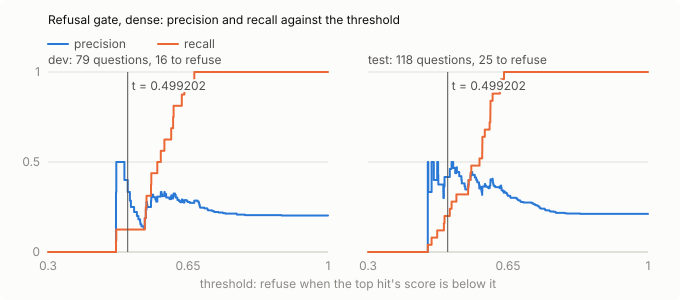
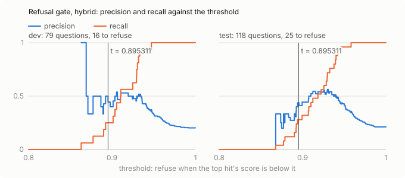

# RAG evaluation

Run `2026-11-28-gte`, collected 2026-11-28. Collection `toolchain_docs`: 3571 chunks (fixed, 800 characters, 120 overlap), embedded with `text-embedding-3-small`. Hybrid mode adds BM25 and a cross-encoder reranker to the dense search.

Golden set: 197 questions (sha256 `7be5db05284c`): ambiguous 15, lookup 98, multi_hop 43, no_answer 41; synthetic 25, targeted 172.

Each stage records the service's settings when it starts, and every stage of a run serves the same collection:

|  | retrieval | answers |
|---|---|---|
| collected | 2026-11-28 | 2026-11-28 |
| `top_k` asked for | 10 | 5 |
| refusal thresholds (dense / hybrid) | 0.499202 / 0.895311 | 0.499202 / 0.895311 |
| generator | `gpt-4o-mini` (openai) | `gpt-4o-mini` (openai) |
| citation verification | on | on |

## Retrieval

The 156 answerable questions (every category but no_answer), top 10 hits from `/v1/search`. A hit is relevant to an evidence item if it contains one of the item's quotes; an item found by several hits counts once, at its first rank, so recall and nDCG measure the facts found, not the chunks.

| mode | n | R@1 | R@3 | R@5 | R@10 | MRR@10 | nDCG@10 |
|---|---|---|---|---|---|---|---|
| dense | 156 | 0.391 | 0.575 | 0.651 | 0.736 | 0.604 | 0.620 |
| hybrid | 156 | 0.494 | 0.683 | 0.750 | 0.785 | 0.711 | 0.705 |

### By category

| mode | category | n | R@1 | R@3 | R@5 | R@10 | MRR@10 | nDCG@10 |
|---|---|---|---|---|---|---|---|---|
| dense | ambiguous | 15 | 0.133 | 0.278 | 0.311 | 0.439 | 0.436 | 0.350 |
| dense | lookup | 98 | 0.488 | 0.663 | 0.735 | 0.801 | 0.614 | 0.668 |
| dense | multi_hop | 43 | 0.259 | 0.476 | 0.581 | 0.691 | 0.639 | 0.604 |
| hybrid | ambiguous | 15 | 0.156 | 0.283 | 0.433 | 0.456 | 0.467 | 0.384 |
| hybrid | lookup | 98 | 0.629 | 0.794 | 0.830 | 0.840 | 0.741 | 0.764 |
| hybrid | multi_hop | 43 | 0.304 | 0.569 | 0.679 | 0.772 | 0.726 | 0.681 |

### By origin

Synthetic questions were drafted from one chunk and share its wording, which flatters retrieval: read them against the targeted ones.

| mode | origin | n | R@1 | R@3 | R@5 | R@10 | MRR@10 | nDCG@10 |
|---|---|---|---|---|---|---|---|---|
| dense | synthetic | 25 | 0.560 | 0.720 | 0.760 | 0.800 | 0.639 | 0.678 |
| dense | targeted | 131 | 0.358 | 0.547 | 0.631 | 0.724 | 0.597 | 0.609 |
| hybrid | synthetic | 25 | 0.640 | 0.760 | 0.840 | 0.840 | 0.713 | 0.745 |
| hybrid | targeted | 131 | 0.466 | 0.668 | 0.733 | 0.774 | 0.710 | 0.697 |

### By split

| mode | split | n | R@1 | R@3 | R@5 | R@10 | MRR@10 | nDCG@10 |
|---|---|---|---|---|---|---|---|---|
| dense | dev | 63 | 0.433 | 0.617 | 0.683 | 0.743 | 0.642 | 0.647 |
| dense | test | 93 | 0.362 | 0.546 | 0.630 | 0.731 | 0.579 | 0.601 |
| hybrid | dev | 63 | 0.489 | 0.703 | 0.781 | 0.818 | 0.700 | 0.715 |
| hybrid | test | 93 | 0.497 | 0.669 | 0.729 | 0.762 | 0.718 | 0.698 |

## What MCP search returns to an agent

MCP `search` returns whole passages, best first, while its result stays within 3600 characters, then for the remaining hits the lines that best match the query. Evidence recall on the test split (93 answerable questions) with whole chunks and as `search` returns them, for `top_k` 3, 5 and 8 (the most it takes), from the recorded hits sized by the server's own code:

| mode | n | R@3 full | R@3 as returned | R@5 full | R@5 as returned | R@8 full | R@8 as returned |
|---|---|---|---|---|---|---|---|
| dense | 93 | 0.546 | 0.546 | 0.630 | 0.592 | 0.706 | 0.538 |
| hybrid | 93 | 0.669 | 0.669 | 0.729 | 0.694 | 0.754 | 0.636 |

Every hit shares the one budget, so the more hits, the shorter the excerpts after the whole ones.

Before, `search` cut each hit to its first characters. The snippets it compared:

| mode | n | R@3 300 chars | R@5 150 chars |
|---|---|---|---|
| dense | 93 | 0.248 | 0.136 |
| hybrid | 93 | 0.295 | 0.170 |

The rule was to switch from 3 hits of 300 characters to 5 of 150 only if that raised hybrid recall by at least 5 points. 5 × 150 was -12.5 points, so `search` kept **3 × 300** until it returned whole passages.

## Refusal calibration

Each mode's threshold is chosen on the dev split alone, from run `2026-11-28-gate-off` (collected 2026-11-28), which answered with the gate off (every threshold 0), so the model's own refusals are known for every question. The threshold is the highest at which at most 10% of dev's answerable questions are refused, by the gate or by the model: a user loses the answer either way, and a higher threshold refuses more no_answer questions, so it is the strictest gate the bound allows. It is printed as the value to configure; the gate refuses strictly below it, so the question it was chosen at passes.

| mode | answerable refused by the model, gate off | threshold chosen | configured | answerable refused at it | no_answer refused by the model, gate off | no_answer refused at it |
|---|---|---|---|---|---|---|
| dense | 5/63 · 0.079 [0.03, 0.17] | 0.499202 | 0.499202 | 6/63 · 0.095 [0.04, 0.19]: gate 2, model 4 | 16/16 | 16/16 |
| hybrid | 4/63 · 0.063 [0.02, 0.15] | 0.895311 | 0.895311 | 6/63 · 0.095 [0.04, 0.19]: gate 4, model 2 | 16/16 | 16/16 |

## Refusal gate

The gate refuses before generating when the top hit's score is below the mode's threshold; a question should be refused if and only if it is no_answer. The configured threshold is the one chosen by false refusals (Refusal calibration); the threshold with the highest F1 on the dev split (ties to the lower) is shown beside it. Both are measured on the test split (118 questions, 25 to refuse), with 95 % Wilson intervals. A chosen threshold is printed as the value to configure: the dev score it was chosen at, truncated so that every decision stays the same (the gate refuses strictly below it, so rounding up would refuse that question). Gate only: refusals by the model itself come from the answer run.

| mode | threshold | TP | FP | FN | TN | precision | recall | F1 |
|---|---|---|---|---|---|---|---|---|
| dense | 0.617442 (highest F1 on dev) | 22 | 38 | 3 | 55 | 0.367 [0.26, 0.49] | 0.880 [0.70, 0.96] | 0.518 |
| dense | 0.499202 (configured) | 5 | 7 | 20 | 86 | 0.417 [0.19, 0.68] | 0.200 [0.09, 0.39] | 0.270 |
| hybrid | 0.934309 (highest F1 on dev) | 19 | 16 | 6 | 77 | 0.543 [0.38, 0.70] | 0.760 [0.57, 0.89] | 0.633 |
| hybrid | 0.895311 (configured) | 7 | 9 | 18 | 84 | 0.438 [0.23, 0.67] | 0.280 [0.14, 0.48] | 0.341 |

### Refusals by no_answer kind

No_answer questions come in kinds: near-miss (the docs cover a neighbouring feature), knows-elsewhere (a fact a model may know from other sources that the pinned docs don't state) and out-of-scope (pricing, roadmaps, benchmarks). How many of each the gate refuses, as counts (each kind has only a few questions); the median is the kind's top score over both splits, and the dev rows are the ones the threshold was chosen on.

| mode | kind | median top score | dev refused (chosen) | test refused (chosen) | test refused (configured) |
|---|---|---|---|---|---|
| dense | near-miss | 0.573 | 9/11 | 17/18 | 4/18 |
| dense | knows-elsewhere | 0.575 | 2/2 | 2/4 | 1/4 |
| dense | out-of-scope | 0.589 | 2/3 | 3/3 | 0/3 |
| hybrid | near-miss | 0.925 | 10/11 | 13/18 | 5/18 |
| hybrid | knows-elsewhere | 0.913 | 2/2 | 3/4 | 1/4 |
| hybrid | out-of-scope | 0.908 | 3/3 | 3/3 | 1/3 |

## Answers

`POST /v1/ask` with `top_k` 5 in both modes, generated by `gpt-4o-mini` (openai). Judge: `anthropic:claude-haiku-4-5 prompts v3`.
An answerable question the system refused fails correctness without a judge call, and a no_answer question is correct if and only if it was refused; otherwise an answer passes at a rating of 4 or 5. Faithfulness is the share of an answer's claims that its retrieved contexts support, judged without the reference answer.

| mode | n | correct [95 % CI] | mean rating | faithfulness | fully supported | citations (self-check) | cost/query | P50 ms | P95 ms |
|---|---|---|---|---|---|---|---|---|---|
| dense | 197 | 0.685 [0.62, 0.75] | 4.085 | 0.913 | 0.760 [0.68, 0.83] | 0.936 | $0.00024 | 2,952 | 6,253 |
| hybrid | 197 | 0.701 [0.63, 0.76] | 4.088 | 0.951 | 0.869 [0.80, 0.92] | 0.961 | $0.00025 | 18,312 | 23,063 |

The mean rating is over the answers the judge rated (answerable and not refused). The judge rates a complete answer that adds correct detail beyond the reference 4 rather than 5, so the mean understates thorough answers; the pass rate is unaffected. Citations (self-check) is the pipeline's own verdict on its citations, n/a when it doesn't verify them. Faithfulness, fully supported and the citation self-check only cover the answers a mode gave, not its refusals, so a mode that refuses more of its harder questions can score higher on them: they compare how answers are grounded, not which mode does better end to end. Correctness is the end-to-end measure.

### Correct by category

| mode | category | n | correct [95 % CI] | mean rating | faithfulness |
|---|---|---|---|---|---|
| dense | ambiguous | 15 | 0.067 [0.01, 0.30] | 2.538 | 0.974 |
| dense | lookup | 98 | 0.684 [0.59, 0.77] | 4.430 | 0.908 |
| dense | multi_hop | 43 | 0.605 [0.46, 0.74] | 3.892 | 0.902 |
| dense | no_answer | 41 | 1.000 [0.91, 1.00] | n/a | n/a |
| hybrid | ambiguous | 15 | 0.067 [0.01, 0.30] | 2.667 | 0.986 |
| hybrid | lookup | 98 | 0.735 [0.64, 0.81] | 4.307 | 0.951 |
| hybrid | multi_hop | 43 | 0.558 [0.41, 0.70] | 4.027 | 0.938 |
| hybrid | no_answer | 41 | 1.000 [0.91, 1.00] | n/a | n/a |

### Refusals end to end (test split)

The gate and the model together: a refusal by either counts.

| mode | n | TP | FP | FN | TN | precision | recall | F1 | by gate | by model |
|---|---|---|---|---|---|---|---|---|---|---|
| dense | 118 | 25 | 20 | 0 | 73 | 0.556 [0.41, 0.69] | 1.000 [0.87, 1.00] | 0.714 | 12 | 33 |
| hybrid | 118 | 25 | 13 | 0 | 80 | 0.658 [0.50, 0.79] | 1.000 [0.87, 1.00] | 0.794 | 16 | 22 |

### No_answer questions by kind

No_answer questions come in kinds: near-miss (the docs cover a neighbouring feature), knows-elsewhere (a fact a model may know from other sources that the pinned docs don't state) and out-of-scope (pricing, roadmaps, benchmarks). Who declined each one: the gate (before generating), the model (after reading the contexts), or nobody (it was answered).

| mode | kind | split | n | refused by gate | refused by model | answered |
|---|---|---|---|---|---|---|
| dense | near-miss | dev | 11 | 1 | 10 | 0 |
| dense | near-miss | test | 18 | 4 | 14 | 0 |
| dense | knows-elsewhere | dev | 2 | 1 | 1 | 0 |
| dense | knows-elsewhere | test | 4 | 1 | 3 | 0 |
| dense | out-of-scope | dev | 3 | 0 | 3 | 0 |
| dense | out-of-scope | test | 3 | 0 | 3 | 0 |
| hybrid | near-miss | dev | 11 | 2 | 9 | 0 |
| hybrid | near-miss | test | 18 | 5 | 13 | 0 |
| hybrid | knows-elsewhere | dev | 2 | 1 | 1 | 0 |
| hybrid | knows-elsewhere | test | 4 | 1 | 3 | 0 |
| hybrid | out-of-scope | dev | 3 | 1 | 2 | 0 |
| hybrid | out-of-scope | test | 3 | 1 | 2 | 0 |

Spend in this run: RAG $0.0959, judge $1.7342 (a cached verdict costs nothing).

### Judge agreement with a human

4 rated answers graded pass or fail by a person who didn't see the judge's verdict: raw agreement 1.000, Cohen's κ n/a (both raters constant). With this few items, κ is a coarse check.

## Answerable questions refused

Every split. A refusal of an answerable question withholds an answer the docs hold; the gate refuses before generation, the model after reading the contexts. Shares with 95 % Wilson intervals.

| stratum | dense: refused | dense: by gate | dense: by model | hybrid: refused | hybrid: by gate | hybrid: by model |
|---|---|---|---|---|---|---|
| all | 27/156 · 0.173 [0.12, 0.24] | 10/156 · 0.064 [0.04, 0.11] | 17/156 · 0.109 [0.07, 0.17] | 19/156 · 0.122 [0.08, 0.18] | 13/156 · 0.083 [0.05, 0.14] | 6/156 · 0.038 [0.02, 0.08] |
| category ambiguous | 2/15 · 0.133 [0.04, 0.38] | 2/15 · 0.133 [0.04, 0.38] | 0/15 · 0.000 [0.00, 0.20] | 3/15 · 0.200 [0.07, 0.45] | 3/15 · 0.200 [0.07, 0.45] | 0/15 · 0.000 [0.00, 0.20] |
| category lookup | 19/98 · 0.194 [0.13, 0.28] | 7/98 · 0.071 [0.04, 0.14] | 12/98 · 0.122 [0.07, 0.20] | 10/98 · 0.102 [0.06, 0.18] | 6/98 · 0.061 [0.03, 0.13] | 4/98 · 0.041 [0.02, 0.10] |
| category multi_hop | 6/43 · 0.140 [0.07, 0.27] | 1/43 · 0.023 [0.00, 0.12] | 5/43 · 0.116 [0.05, 0.24] | 6/43 · 0.140 [0.07, 0.27] | 4/43 · 0.093 [0.04, 0.22] | 2/43 · 0.047 [0.01, 0.15] |
| split dev | 7/63 · 0.111 [0.05, 0.21] | 3/63 · 0.048 [0.02, 0.13] | 4/63 · 0.063 [0.02, 0.15] | 6/63 · 0.095 [0.04, 0.19] | 4/63 · 0.063 [0.02, 0.15] | 2/63 · 0.032 [0.01, 0.11] |
| split test | 20/93 · 0.215 [0.14, 0.31] | 7/93 · 0.075 [0.04, 0.15] | 13/93 · 0.140 [0.08, 0.22] | 13/93 · 0.140 [0.08, 0.22] | 9/93 · 0.097 [0.05, 0.17] | 4/93 · 0.043 [0.02, 0.11] |
| origin synthetic | 1/25 · 0.040 [0.01, 0.20] | 0/25 · 0.000 [0.00, 0.13] | 1/25 · 0.040 [0.01, 0.20] | 0/25 · 0.000 [0.00, 0.13] | 0/25 · 0.000 [0.00, 0.13] | 0/25 · 0.000 [0.00, 0.13] |
| origin targeted | 26/131 · 0.198 [0.14, 0.27] | 10/131 · 0.076 [0.04, 0.13] | 16/131 · 0.122 [0.08, 0.19] | 19/131 · 0.145 [0.09, 0.22] | 13/131 · 0.099 [0.06, 0.16] | 6/131 · 0.046 [0.02, 0.10] |

## Hybrid against dense, question by question

End-to-end correctness, every question (a no_answer question is correct iff refused). Exact McNemar test: only the questions one mode gets right and the other wrong count; p is two-sided.

| stratum | questions | only dense correct | only hybrid correct | p |
|---|---|---|---|---|
| all | 197 | 9 | 12 | 0.664 |
| category ambiguous | 15 | 0 | 0 | 1.000 |
| category lookup | 98 | 6 | 11 | 0.332 |
| category multi_hop | 43 | 3 | 1 | 0.625 |
| category no_answer | 41 | 0 | 0 | 1.000 |
| split dev | 79 | 3 | 6 | 0.508 |
| split test | 118 | 6 | 6 | 1.000 |
| origin synthetic | 25 | 1 | 2 | 1.000 |
| origin targeted | 172 | 8 | 10 | 0.815 |

Retrieval, answerable questions: the mean of hybrid − dense per question, with a 95 % paired bootstrap percentile interval (10,000 resamples, seed 0).

| stratum | questions | R@1 | R@3 | R@5 | R@10 | MRR@10 | nDCG@10 |
|---|---|---|---|---|---|---|---|
| all | 156 | +0.103 [+0.040, +0.167] | +0.108 [+0.059, +0.161] | +0.099 [+0.057, +0.143] | +0.049 [+0.017, +0.082] | +0.107 [+0.056, +0.158] | +0.085 [+0.048, +0.123] |
| category ambiguous | 15 | +0.022 [-0.078, +0.122] | +0.006 [-0.100, +0.117] | +0.122 [-0.022, +0.267] | +0.017 [-0.133, +0.167] | +0.030 [-0.114, +0.168] | +0.034 [-0.095, +0.158] |
| category lookup | 98 | +0.141 [+0.046, +0.238] | +0.131 [+0.063, +0.202] | +0.095 [+0.046, +0.151] | +0.039 [+0.005, +0.082] | +0.127 [+0.061, +0.194] | +0.096 [+0.046, +0.148] |
| category multi_hop | 43 | +0.046 [-0.018, +0.107] | +0.093 [+0.008, +0.176] | +0.099 [+0.017, +0.186] | +0.081 [+0.029, +0.136] | +0.087 [-0.005, +0.183] | +0.078 [+0.023, +0.136] |
| split dev | 63 | +0.056 [-0.060, +0.168] | +0.086 [+0.004, +0.173] | +0.098 [+0.037, +0.164] | +0.075 [+0.015, +0.139] | +0.058 [-0.034, +0.150] | +0.068 [+0.001, +0.136] |
| split test | 93 | +0.135 [+0.064, +0.211] | +0.124 [+0.063, +0.189] | +0.099 [+0.043, +0.159] | +0.030 [+0.000, +0.065] | +0.140 [+0.083, +0.200] | +0.096 [+0.055, +0.140] |
| origin synthetic | 25 | +0.080 [-0.080, +0.240] | +0.040 [-0.080, +0.160] | +0.080 [+0.000, +0.200] | +0.040 [+0.000, +0.120] | +0.074 [-0.032, +0.201] | +0.067 [-0.023, +0.178] |
| origin targeted | 131 | +0.108 [+0.037, +0.179] | +0.121 [+0.067, +0.177] | +0.102 [+0.057, +0.151] | +0.050 [+0.017, +0.087] | +0.113 [+0.056, +0.169] | +0.088 [+0.049, +0.128] |

## Ambiguous questions: readings retrieved

Each evidence item of an ambiguous question is one reading, and the reference answer needs all of them. Readings covered by the top 5 hits of the recorded search (`/ask` was run with `top_k` 5), and how the answer came out.

| question | dense: readings in top 5 | dense: answer | hybrid: readings in top 5 | hybrid: answer |
|---|---|---|---|---|
| q045 | 1 of 2 | rated 3 | 1 of 2 | rated 3 |
| q046 | 1 of 3 | rated 2 | 2 of 3 | rated 3 |
| q047 | 2 of 2 | refused by gate | 1 of 2 | rated 3 |
| q048 | 1 of 2 | rated 3 | 1 of 2 | rated 3 |
| q049 | 1 of 2 | rated 3 | 1 of 2 | rated 3 |
| q050 | 1 of 2 | rated 3 | 1 of 2 | rated 3 |
| q141 | 0 of 2 | rated 3 | 1 of 2 | rated 2 |
| q142 | 0 of 3 | refused by gate | 2 of 3 | refused by gate |
| q143 | 0 of 2 | rated 1 | 0 of 2 | rated 1 |
| q144 | 1 of 3 | rated 3 | 2 of 3 | rated 3 |
| q145 | 0 of 2 | rated 2 | 0 of 2 | refused by gate |
| q146 | 2 of 4 | rated 4 | 2 of 4 | rated 4 |
| q148 | 0 of 2 | rated 1 | 0 of 2 | rated 2 |
| q149 | 0 of 2 | rated 2 | 0 of 2 | rated 2 |
| q150 | 1 of 2 | rated 3 | 2 of 2 | refused by gate |
