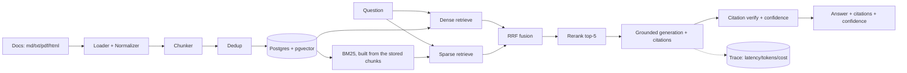

# RAG Hybrid Search

The retrieval service of [Groundwork](../../README.md).

[](https://github.com/AlirezaAbedinii/groundwork-agents/actions/workflows/ci.yml)

[](https://github.com/astral-sh/ruff)


> Hybrid-search RAG over technical docs. On a 75-question golden set over the uv,
> Pydantic and FastAPI documentation, **67–69 % of answers are correct** and
> **0.91–0.96 of their claims are supported** by the passages they cite, as judged
> by a model from another provider; **every unanswerable question is refused**; a
> query costs about **$0.0002** with a **P95 of 5–6 s**.
>
> The numbers come from the repository's evaluation suite and its published
> [report](../../eval/reports/rag.md) (2026-10-06, `text-embedding-3-small`,
> `gpt-4o-mini`, citation verification on); [`eval/`](../../eval/README.md) explains
> how they were measured and recomputes them for free.

A production-grade **Retrieval-Augmented Generation** service: it ingests
multi-format documentation, retrieves the most relevant passages, and generates
**grounded answers with inline `[n]` citations** — refusing to answer when the
retrieved context isn't strong enough rather than hallucinating. Every request
is instrumented for **per-stage latency and cost-per-query**.

## Architecture



Every stage shown is implemented and tested: multi-format ingestion (Markdown,
text, PDF, HTML) with three switchable chunkers and near-duplicate dedup; dense
(Postgres with pgvector, HNSW) and sparse (BM25, built from the same stored
chunks) retrieval; RRF fusion and local
cross-encoder reranking on the hybrid path; grounded generation with parsed,
**LLM-judge-verified** citations and a composite confidence score; and a
per-request latency/cost trace — served by FastAPI + Streamlit in Docker.

## Why hybrid retrieval for technical docs

Dense (embedding) retrieval is excellent at *meaning*: "How do I install the
CLI?" finds the quickstart even with zero shared words. But technical docs are
full of **exact tokens** — error codes (`FERRY-429`), config keys
(`ferry.worker.concurrency`), function names — where embeddings blur exactly the
signal that matters, and classical keyword search (BM25) excels. Hybrid retrieval
runs both, merges the rankings with **Reciprocal Rank Fusion**, and lets a local
**cross-encoder** rerank the shortlist for precision.

The evaluation puts that claim to the test, and the answer depends on the
embeddings. With `text-embedding-3-small` on the 3,571-chunk docs corpus, the two
modes find the same share of the needed facts (Recall@10 0.763 dense, 0.761
hybrid) and answer about equally well (69 % and 67 % correct; no evidence of a
difference on 75 questions): strong embeddings already carry the exact tokens.
Hybrid stays the default because it costs little (BM25 and the reranker run
locally) and protects the weaker, keyless embedding setup. Its reranker scores
also feed the refusal gate on a different scale from dense cosine similarity, which
is why each mode has its own calibrated threshold
([ADR 0007](../../docs/decisions/0007-refusal-threshold-calibration.md)).

## Quickstart (60 seconds)

Requires Docker; the default settings use an OpenAI key (keyless below).

```bash
git clone https://github.com/AlirezaAbedinii/groundwork-agents.git && cd groundwork-agents/services/rag
cp .env.example .env                 # put your OPENAI_API_KEY in .env
docker compose up -d --build         # Postgres :5433, API :8000, UI :8501, MCP :8001/mcp
docker compose run --rm seed         # index the sample Ferry corpus (idempotent)

curl -X POST http://localhost:8000/v1/ask \
  -H "Content-Type: application/json" \
  -d '{"question": "What does FERRY-429 mean?", "mode": "hybrid", "top_k": 5}'
```

Then open the UI at <http://localhost:8501> or the OpenAPI docs at
<http://localhost:8000/docs>. The `/v1/ask` response carries the answer, `[n]`
citations mapped to source chunks, the ranked retrieved contexts, a confidence
score, whether and by what it refused (`refused_by`: the gate before generating, or
the model after reading the contexts), the top retrieval score, token usage,
`cost_usd`, and per-stage `timings_ms`. Other endpoints: `POST /v1/search`
(retrieval only: ranked chunks with scores, nothing generated, so no generation
key), `POST /v1/ingest`, `GET /v1/documents`, `GET /v1/chunks?source_file=…` (a
document's stored chunks), `GET /v1/config` (the collection, models, thresholds and
how the index was built; no secrets) and `GET /v1/stats`.

**Keyless:** set `EMBEDDING_PROVIDER=sentence_transformers` and the MiniLM model in
`.env` (`.env.example` shows the lines); seeding, `/v1/search` and `/v1/documents`
then need no key, and only `/v1/ask` needs the generation key.

**The evaluation corpus:** `python3 scripts/fetch_corpus.py toolchain_docs` fetches
the uv, Pydantic and FastAPI docs at the release commits pinned in
[`corpora/toolchain_docs.json`](corpora/toolchain_docs.json) (253 files, checked by
hash, never committed); seed them under their own collection with
`CORPUS_DIR=data/raw/toolchain_docs` and `COLLECTION=…`. Each collection records the
embedding model that built it, and the API refuses to serve one built by another
model ([ADR 0005](../../docs/decisions/0005-pgvector-over-chroma.md)).

**The images:** the [Dockerfile](Dockerfile) has two targets. `api` (the API and the
seeder) runs Python 3.12 with the CPU-only torch build, and pins the libraries that
decide the reranker's scores in [`docker/constraints.txt`](docker/constraints.txt),
at the versions the published numbers came from. The cross-encoder is downloaded at
build time, so a container never fetches it (`HF_HUB_OFFLINE=1` makes that strict).
`ui` is Streamlit alone, which talks to the API over HTTP. Both run as uid 10001;
compose runs `api` and `seed` as root, because `./data` is a bind mount.

<details>
<summary>Local development (only the database in Docker)</summary>

```bash
python -m venv .venv && source .venv/bin/activate   # Python 3.11+
pip install -e ".[dev]"
make test                                # deterministic suite; no key needed
python scripts/ingest.py --dry-run       # chunk the corpus; no key needed

pip install -e ".[ingestion,indexing,llm,api]"      # full local stack
cp .env.example .env                     # set OPENAI_API_KEY
docker compose up -d --wait db           # Postgres + pgvector on :5433
python scripts/seed.py                   # build the index
make run-api                             # uvicorn on :8000
```
</details>

## MCP

The stack also runs the MCP server from [`mcp/`](../../mcp/README.md), which
offers this API to agents as tools; the agents in
[`services/agent`](../agent/README.md) call it that way. Each tool call is one
request here:

| MCP tool | Endpoint |
|---|---|
| `search` | `POST /v1/search`: ranked chunks, nothing generated, so no generation key |
| `ask` | `POST /v1/ask` |
| `list_sources` | `GET /v1/documents` |

## Evaluation results

The service is evaluated from outside, over its API, by the suite in
[`eval/`](../../eval/README.md), with a golden set of 75 questions over the docs
corpus (lookups, multi-hop questions, questions the docs can't answer, and ambiguous
ones), labelled with verbatim evidence quotes. Answers are judged by
`claude-haiku-4-5`, from another provider than the generator, and a blind human check
agrees with the judge at κ 0.83 ([full report](../../eval/reports/rag.md)).

| Metric | Dense | Hybrid |
|---|---|---|
| Recall@10 (57 answerable questions) | 0.763 | 0.761 |
| nDCG@10 | 0.661 | 0.655 |
| Answers correct (75 questions) | 0.693 [0.58, 0.79] | 0.667 [0.55, 0.76] |
| Faithfulness (supported claims) | 0.910 | 0.963 |
| Unanswerable questions refused (test split) | 11/11 | 11/11 |
| Answerable questions refused too (test split) | 6 of 34 | 8 of 34 |
| Cost per query | $0.00019 | $0.00020 |
| P50 / P95 latency | 2.3 s / 5.4 s | 2.7 s / 6.2 s |

Where it falls short: ambiguous questions score 0/6 (the prompt never asks the model
to name the readings), and hybrid's gate, calibrated where the reranker's scores
crowd near 1, refuses some answerable questions just below its threshold. The
tables measured on the earlier seven-file Ferry corpus, with the retired harness,
are in the [history](https://github.com/AlirezaAbedinii/groundwork-agents/tree/940677e9078e4cd4d8a70aecb74f26c8295435d0/services/rag).

## Latency & cost

Instrumentation is built in from the first request, not sampled after the fact:
every query records **per-stage latency** (`embed`, `dense`, `generate`, …
`total_ms`) and **token-based cost** (prompt/completion tokens × configured
prices) into a SQLite trace store. `GET /v1/stats` serves the rollup —
**P50/P95/P99 per stage** plus cost totals — and the Streamlit UI shows the same
per-request panel.

Measured in the evaluation's answer run (75 questions per mode, `gpt-4o-mini`,
citation verification on): P50 2.3 s and P95 5.4 s in dense mode, 2.7 s and 6.2 s
in hybrid mode, at $0.00019–0.00020 per query. The per-stage breakdown on the earlier Ferry
corpus put retrieval at a few milliseconds and the CPU reranker at about 350 ms,
with the LLM round trips (generation, then one verification per citation) taking
the rest, so batching the verification is the lever, not retrieval.

## Design decisions

- **Chunking:** fixed-size sliding window (800 chars, 120 overlap) as the
  measured baseline, plus structure-aware recursive and semantic chunkers —
  switchable via config, each indexed in isolation, so the comparison above is
  apples-to-apples.
- **Retrieval:** dense top-k over pgvector (cosine, HNSW) fused with BM25 via **RRF**
  at 0.7 dense / 0.3 sparse (configurable, k=60), then a local cross-encoder
  (`ms-marco-MiniLM-L-6-v2`) reranks top-20 → top-5 — precision without extra
  LLM spend. The BM25 tokenizer keeps compound tokens (`FERRY-429`,
  `ferry.worker.concurrency`) whole, which is what makes exact-token retrieval
  work.
- **"I don't know" policy:** if the top retrieval score falls below the mode's
  threshold, the service returns a structured refusal **before** calling the
  LLM: no fabrication, no wasted generation cost. Dense scores are cosine
  similarities and hybrid scores come from the reranker, so each mode has its own
  threshold (0.617442 dense, 0.963599 hybrid), chosen on held-out questions for
  `text-embedding-3-small` and this reranker
  ([ADR 0007](../../docs/decisions/0007-refusal-threshold-calibration.md)). The model
  can still decline after reading the contexts, and the response says which one
  refused.
- **Citations are verifiable:** answers cite `[n]` against the exact numbered
  context they were generated from; citations pointing outside the retrieved
  set are flagged, and an LLM-as-judge pass confirms each cited chunk actually
  supports its claim (unsupported ones are surfaced, and lower the composite
  confidence). That answer-time pass uses the generation model.
- **One LLM provider** (OpenAI *or* Anthropic behind one interface) — no
  multi-provider routing. **Postgres with pgvector** as the only store
  ([ADR 0005](../../docs/decisions/0005-pgvector-over-chroma.md)).
  **Streamlit, not React; no auth; no streaming** — deliberately out of scope to
  keep the project focused and finishable.

## Project layout

```
src/rag/
├── config.py            # settings, model IDs, token prices, thresholds (env)
├── ingestion/           # loaders, normalizer, chunkers
├── indexing/            # embeddings client, pgvector store, BM25, index_path()
├── retrieval/           # dense retrieval + dense/hybrid mode switch
├── generation/          # grounded prompt, LLM client, citation parsing
├── observability/       # per-stage timers, cost accounting, trace store
├── api/                 # FastAPI: /v1/ask /v1/search /v1/ingest /v1/documents /v1/chunks /v1/config /v1/stats
└── pipeline.py          # retrieve → gate → generate → cite
ui/app.py                # Streamlit front end
corpora/                 # pinned manifests of public docs corpora (toolchain_docs.json)
scripts/                 # ingest.py (CLI), seed.py (index a corpus), fetch_corpus.py (download a pinned corpus)
tests/                   # deterministic tests (LLM mocked)
```

## Tests & CI

```bash
make test     # pytest — deterministic, no network, LLM mocked
make lint     # ruff
```

CI (badge above) runs **ruff + pytest** on every push — no paid API calls in
CI. The suite covers loaders/chunkers on real fixtures, citation-parser edge
cases, retrieval ranking with injected fakes, the refusal gate, and the API
contract (happy path, validation, error surfaces).

## Status

Feature-complete: ingestion (md/txt/pdf/html, three switchable chunkers, dedup),
hybrid retrieval (dense + BM25 → RRF → cross-encoder rerank), grounded
generation with judge-verified citations and composite confidence, per-stage
latency/cost instrumentation, FastAPI + Streamlit + Docker. A demo storyboard
lives in [`DEMO.md`](DEMO.md).

## License

[MIT](LICENSE)
